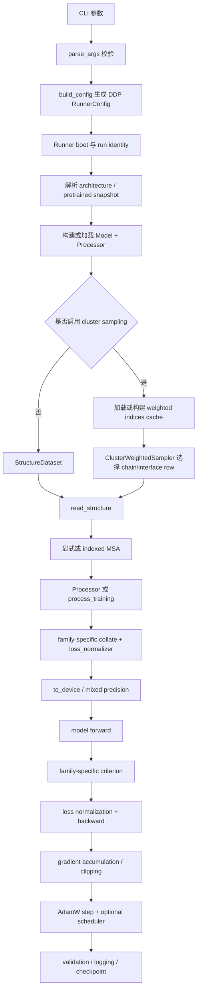

# OFoldX 训练脚本

OFoldX 的 canonical 原生训练入口是 `python -m ofoldx.runners.train`，实现位于
`ofoldx/runners/train.py`；[`scripts/train.py`](./train.py) 仅是兼容 wrapper。canonical
module 负责把命令行参数转换成 `ofoldx.runners.Runner` 配置，并由 Runner 完成
模型/Processor 构建、数据读取、MSA 加载、cluster-weighted sampling、forward、loss、
backward、优化器更新、验证、日志和 checkpoint。

> 当前默认模型是从零初始化的完整 Protenix，通常需要 GPU。OFoldX Runner 对
> Protenix 使用 EDM coordinate-denoising objective；这不是 upstream Protenix
> 完整的多阶段 total loss。

## Slurm 提交

直接提交默认的 mini-dataset cluster-sampling 训练：

```bash
sbatch scripts/submit_train.slurm
```

该命令使用 1 张 A800、4 CPU、96G 内存、indexed MSA、本地 CCD、CUDA bf16，并从
`tmp/clusters-by-entity-40.txt` 按 cluster 抽样 1 个 epoch（100 个样本）。索引持久化到
`tmp/ofoldx-train/cache/mini-cluster-indices.jsonl`。

通过 `--export=ALL,VAR=value` 覆盖训练边界和常用设置：

```bash
sbatch --export=ALL,EPOCHS=3,CLUSTER_EPOCH_SIZE=1000,RUN_NAME=mini-3ep scripts/submit_train.slurm
```

`STEPS=N` 可代替 epoch 边界；`EPOCHS` 和 `STEPS` 不能同时设置。

资源由 `sbatch` 参数覆盖。例如改用 2 小时时限和 8 个 CPU：

```bash
sbatch --time=02:00:00 --cpus-per-task=8 \
  --export=ALL,STEPS=1000,WORKERS=4,RUN_NAME=protenix-1k \
  scripts/submit_train.slurm
```

路径含逗号时不要通过 `--export` 传递，因为 Slurm 使用逗号分隔变量。可导出的变量如下：

| 变量 | 默认值 | 用途 |
| --- | --- | --- |
| `REPO_ROOT` | `/data/users/qinghanw313/AlloDesign` | 仓库根目录。 |
| `PYTHON` | `/data/users/qinghanw313/miniforge3/envs/allodesign-cu132/bin/python` | Python executable。 |
| `TRAIN_SOURCE` | `$REPO_ROOT/tmp/mini_dataset` | 训练结构 source。 |
| `CLUSTER_FILE` | `$REPO_ROOT/tmp/clusters-by-entity-40.txt` | entity cluster 文件。 |
| `CLUSTER_INDICES_FILE` | `$REPO_ROOT/tmp/ofoldx-train/cache/mini-cluster-indices.jsonl` | 持久化 indices cache。 |
| `CLUSTER_EPOCH_SIZE` | `100` | 每个 epoch 的 cluster-sampled 样本数。 |
| `SEQ_TO_PDB_INDEX` | `/data/shared/datasets/protenix/seq_to_pdb_index.json` | sequence-to-MSA JSON index。 |
| `MSA_PATH` | `/data/shared/datasets/protenix/mmcif_msa` | indexed MSA 根目录。 |
| `CCD_SNAPSHOT` | `$REPO_ROOT/tmp/ccd-v20240608` | 本地 CCD snapshot。 |
| `WORKSPACE` | `$REPO_ROOT/tmp/ofoldx-train/workspace` | Runner workspace 根目录。 |
| `RUN_NAME` | `protenix-train` | Runner run name。 |
| `EPOCHS` | `1` | 训练 epoch 数；与 `STEPS` 互斥。 |
| `STEPS` | 空 | 可选 optimizer step 边界；设置后代替 `EPOCHS`。 |
| `WORKERS` | `0` | DataLoader worker 数，必须为非负整数。 |
| `DEVICE` | `cuda` | `cuda`、`auto` 或 `cpu`。 |
| `PRECISION` | `bf16` | `bf16` 或 `fp16`。 |
| `CHECKPOINT` | `1` | `1` 开启 checkpoint，`0` 关闭。 |

Slurm stdout/stderr 位于仓库的 `tmp/slurm-ofoldx-<job-name>-<job-id>.{out,err}`；默认
Runner workspace 位于 `$REPO_ROOT/tmp/ofoldx-train/workspace`。注意 `#SBATCH --output` 和
`--error` 在 shell 变量初始化前解析，因此覆盖 `REPO_ROOT` 不会改变 Slurm 日志位置；可用
`sbatch --output=... --error=...` 显式覆盖。

## 快速开始

规范入口是 `python -m ofoldx.runners.train`。`scripts/train.py` 保留为兼容 wrapper，并显式
转发相同的 `parse_args`、`build_config` 和 `main`。

查看实时参数说明：

```bash
python -m ofoldx.runners.train --help
```

先检查最终 Runner 配置；该模式不会构造 Runner、model、dataset，也不会启动训练：

```bash
python -m ofoldx.runners.train data/train --epochs 10 --print-config
```

单 GPU、从零训练默认 Protenix：

```bash
python -m ofoldx.runners.train data/train \
  --epochs 10 \
  --device cuda \
  --precision bf16
```

按 optimizer step 限制一个短任务：

```bash
python -m ofoldx.runners.train data/train \
  --steps 100 \
  --device cuda \
  --precision bf16 \
  --no-checkpoint
```

使用 indexed MSA：

```bash
python -m ofoldx.runners.train /data/users/qinghanw313/AlloDesign/tmp/mini_dataset \
  --seq-to-pdb-index /data/shared/datasets/protenix/seq_to_pdb_index.json \
  --msa-path /data/shared/datasets/protenix/mmcif_msa \
  --steps 100 \
  --device cuda \
  --precision bf16
```

使用 Protenix-style cluster sampling：

```bash
python -m ofoldx.runners.train data/cifs \
  --cluster-file data/clusters.txt \
  --cluster-epoch-size 10000 \
  --device cuda \
  --precision bf16
```

同时评估多个命名数据集，并指定其中一个用于 best-checkpoint score：

```bash
python -m ofoldx.runners.train data/train \
  --val-source data/validation \
  --eval-source benchmark_a=data/benchmark-a \
  --eval-source benchmark_b=data/benchmark-b \
  --score-split benchmark_a \
  --epochs 10 \
  --device cuda \
  --precision bf16
```

显式指定可复用的 indices cache：

```bash
python -m ofoldx.runners.train data/cifs \
  --cluster-file data/clusters.txt \
  --cluster-indices-file experiments/my-indices.jsonl \
  --steps 1000 \
  --device cuda
```

单机多 GPU DDP：

```bash
torchrun --standalone --nproc-per-node=2 --module \
  ofoldx.runners.train data/train \
  --steps 1000 \
  --precision bf16
```

CPU 上验证一个较小的 sequence model：

```bash
python -m ofoldx.runners.train chain.pdb \
  --model ligandmpnn \
  --device cpu \
  --steps 1 \
  --no-checkpoint \
  --no-logging
```

## 输入数据

`train_source`、`--val-source` 和每个 `--eval-source NAME=PATH` 的 `PATH` 支持四种形式：

1. 单个 `.pdb`、`.cif` 或 `.mmcif` 文件；
2. 目录，递归、排序读取其中的结构文件；
3. glob，例如 `'data/**/*.cif'`，建议加引号让脚本而不是 shell 展开；
4. manifest 文本文件，每行是一个结构路径或一个 JSON object。

manifest 中的相对路径以 manifest 所在目录为基准。空行和以 `#` 开头的行会被忽略。

最简单的 manifest：

```text
# train.jsonl
structures/1abc.cif
structures/2def.cif
```

为单个样本显式绑定一份 MSA：

```json
{"structure":"structures/1abc.cif","msa":{"path":"msa/1abc.a3m","entity_id":"1"}}
```

也可以引用编码后的 `MSACollection` JSON：

```json
{"structure":"structures/2def.cif","msa_collection":"msa/2def.json"}
```

同一条 record 不能同时设置 `msa` 和 `msa_collection`。

cluster sampling 只接受 asymmetric-unit `.cif`/`.mmcif`。manifest record 中的
`assembly_id` 必须为空；PDB 输入不能用于 cluster sampling。

## 参数说明

### 数据与训练边界

| 参数 | 默认值 | 含义 |
| --- | --- | --- |
| `train_source` | 必填 | 训练结构文件、目录、glob 或 manifest。 |
| `--val-source PATH` | 无 | 兼容的验证集写法，登记为名为 `val` 的 evaluate split。可与名称不是 `val` 的 `--eval-source` 共存。 |
| `--eval-source NAME=PATH` | 无 | 可重复的命名 evaluate split。名称必须以 ASCII 字母开头，之后只能包含字母、数字、`_`、`-`；不能是 `train`，也不能重复。PATH 可包含 `=`。 |
| `--score-split NAME` | `val` 优先，否则第一个命名 split | 指定唯一用于 score/best-checkpoint 选择的已配置 evaluate split；所有 evaluate split 仍会分别计算并记录 metrics。 |
| `--seq-to-pdb-index PATH` | 无 | exact protein sequence 到 MSA 目录 ID 的 JSON mapping；必须与 `--msa-path` 同时使用。 |
| `--msa-path DIR` | 无 | indexed MSA 根目录；必须与 `--seq-to-pdb-index` 同时使用。 |
| `--epochs N` | `1` | 训练 epoch 数；与 `--steps` 互斥。 |
| `--steps N` | 无 | optimizer step 总数；与 `--epochs` 互斥。 |

如果 `--epochs` 和 `--steps` 都未设置，脚本使用 `--epochs 1`。

每个 evaluate split 的指标以其 split 名区分，例如 `val/loss` 和 `benchmark_a/loss`。
epoch 模式在每个 epoch 结束后评估全部 split；step 模式在训练达到总 step 边界后评估。
`--score-split` 只决定哪个 split 的 `loss` 用于 score 和 best checkpoint，不会跳过其他
split。cluster sampling 与 `--max-tokens`/`--crop-size` 只配置训练集；evaluate split 使用完整
结构且不进行 cluster sampling，因此大结构评估可能比裁剪训练更容易 OOM。Processor 配置和
indexed-MSA 路由由训练集与全部 evaluate split 共享。

若数据集是训练期间从未用于调参或 checkpoint 选择的 held-out test set，建议在模型选择完成后
单独评估。训练期间反复查看其指标会泄漏测试信息；尤其不要把它选为 `--score-split`。

### 模型

| 参数 | 默认值 | 含义 |
| --- | --- | --- |
| `--model ID` | fresh run 为 `protenix` | 从 registry 构建的 architecture ID。只有 Runner 内置 objective 的 architecture 才能训练。 |
| `--pretrained REPO` | 无 | 本地模型仓库或 Hugging Face repository。模型和 Processor 都从该 snapshot 加载。 |
| `--revision REV` | 无 | pretrained repository 的 branch、tag 或 commit；只能与 `--pretrained` 使用。Runner 会固定解析出的 commit。 |
| `--model-config JSON_OR_PATH` | `{}` | fresh model 的配置覆盖；接受 inline JSON object 或 UTF-8 JSON 文件。不能覆盖 `name`、`pretrained`、`revision`。 |
| `--processor-config JSON_OR_PATH` | `{}` | fresh Processor 的构造配置覆盖；接受 inline JSON object 或 JSON 文件。 |
| `--ccd-revision REV` | 无 | fresh Processor 使用的 CCD repository revision；不同于 pretrained model 的 `--revision`。 |
| `--ccd-snapshot-path PATH` | 无 | fresh Processor 使用的本地 CCD snapshot；与 `--ccd-revision` 互斥。 |

pretrained run 不允许非空 `--model-config`、`--processor-config` 或显式 CCD locator，因为
published repository 中的模型与 Processor 配置必须保持配对。显式 CCD flag 也不能与
`--processor-config` 中的 CCD locator key 同时使用。

当前 Runner 内置训练 objective 的 architecture 如下：

| architecture | objective / batching |
| --- | --- |
| `proteinmpnn`, `nampnn` | sequence objective；ragged multi-structure batch。 |
| `ligandmpnn` | sequence objective；`batch_size=1`。 |
| `alphafold3`, `boltz1`, `boltz2`, `boltzgen` | EDM coordinate denoising；调用 `process_training`；`batch_size=1`。 |
| `protenix`, `protenix_template`, `protenix_structure_condition`, `protenix_constraint` | EDM coordinate denoising；调用 `process_training`；`batch_size=1`。 |
| `alphafold2`, `alphafold2_initial_guess`, `alphafold2_multimer` | AlphaFold 2 objective；`batch_size=1`。 |
| `grnade`, `oinvfold` | 对应的结构条件 sequence/design objective；`batch_size=1`。 |
| `odesign` | ODesign objective；调用 `process_training`；`batch_size=1`。 |

Registry 中存在但不在该表内的 architecture 可能支持构建或 inference，但选择训练时会报
`has no built-in Runner objective`。

### 优化

| 参数 | 默认值 | 含义 |
| --- | --- | --- |
| `--lr FLOAT` | `1e-4` | AdamW 初始 learning rate，必须大于 0。 |
| `--weight-decay FLOAT` | `0.01` | AdamW weight decay，必须非负。 |
| `--batch-size N` | `1` | DataLoader 每个 micro-batch 的样本数。多数大结构模型只支持 1。 |
| `--accum-steps N` | `1` | 梯度累积的 micro-batch 数；optimizer step 在累积完成后发生。 |
| `--workers N` | `0` | DataLoader worker 数；0 表示在主进程加载/处理样本。 |
| `--precision {bf16,fp16}` | 无 override | 混合精度模式；省略时使用 Runner/模型默认精度。 |
| `--max-grad-norm FLOAT` | 无 | 设置全局 gradient clipping 上限，必须大于 0。 |
| `--seed N` | `1016` | 全局非负随机种子；也作为默认 cluster sampler seed。 |
| `--deterministic` / `--no-deterministic` | false | 开启或关闭 deterministic execution。 |
| `--gradient-checkpointing` / `--no-gradient-checkpointing` | false | 开启或关闭模型 activation/gradient checkpointing，以重算换取更低显存；与训练状态保存的 `--checkpoint` 独立。 |

对于只支持 `batch_size=1` 的模型，应使用 `--accum-steps` 增大有效 batch。loss 会按各
micro-batch 的有效 residue/atom 数归一化，而不是简单地对结构数平均。

### Learning-rate scheduler

| 参数 | 默认值 | 含义 |
| --- | --- | --- |
| `--scheduler {none,cosine,linear}` | `none` | 不使用 scheduler，或使用按 optimizer step 更新的 cosine/linear scheduler。 |
| `--warmup N` | `0` | 线性 warmup 的 optimizer step 数。仅 scheduler 非 `none` 时写入配置。 |
| `--final-lr-ratio FLOAT` | `0.0` | 最终 learning rate / 初始 learning rate，必须非负。 |

### 运行、日志与 checkpoint

| 参数 | 默认值 | 含义 |
| --- | --- | --- |
| `--device {auto,cpu,cuda}` | `auto` | `auto` 优先可见 CUDA，否则 CPU；`cpu` 会隐藏 CUDA；`cuda` 在 GPU 不可用时直接报错。 |
| `--workspace DIR` | `experiments` | DanLing workspace 根目录。 |
| `--run-name NAME` | model ID；pretrained run 为 `pretrained` | experiment 名称，也是 workspace identity 的一部分。 |
| `--resume` | false | 从当前 run identity 的 latest checkpoint 恢复。 |
| `--resume-from PATH` | 无 | 从显式 checkpoint 恢复；与 `--resume` 互斥。 |
| `--checkpoint` / `--no-checkpoint` | true | 开启或关闭 checkpoint 写入；读取 checkpoint 与该开关独立。 |
| `--checkpoint-interval N` | 自动 | epoch mode 默认每 epoch；step mode 默认约总 steps 的 1/20。单位分别是 epoch 或 optimizer step。 |
| `--keep-latest N` | `0` | 保留最近 N 个历史 checkpoint；0 表示不自动清理历史 checkpoint。 |
| `--logging` / `--no-logging` | true | 开启或关闭 Runner logging。 |
| `--log-interval N` | 自动 | optimizer-step 日志间隔；step mode 默认约总 steps 的 1/100。 |
| `--print-config` | false | 打印最终 plain JSON config 后退出；不会构造 Runner/model/dataset 或启动训练。 |

workspace 的实际目录由 DanLing 根据 root、lineage、experiment 和 run identity 生成。正常训练
结束时会保存最终 model；周期 checkpoint、latest/best 等文件由 checkpoint 配置控制。

### Cluster-weighted CIF sampling

| 参数 | 默认值 | 含义 |
| --- | --- | --- |
| `--cluster-file PATH` | 无 | RCSB entity-cluster 文件；设置后启用 cluster sampling。 |
| `--cluster-indices-file PATH` | 自动 | 指定 versioned OFoldX JSONL indices cache。只能与 `--cluster-file` 使用。 |
| `--cluster-epoch-size N` | indices row 数 | 每个 epoch 的全局抽样数，不是每个 rank 的抽样数。 |
| `--cluster-seed N` | `--seed` | cluster sampler 的独立非负 seed。每个 epoch 使用 `seed + epoch`。 |
| `--cluster-replacement` / `--no-cluster-replacement` | replacement=true | 是否有放回抽样。无放回时必须有足够多的正权重 row 覆盖 DDP padding 后的总数。 |
| `--cluster-contact-cutoff FLOAT`、`--cluster-cutoff FLOAT` | `5.0` Å | 两条 chain 被判为 interface 的原子距离阈值。 |
| `--cluster-all-chain-pairs` / `--no-cluster-all-chain-pairs` | false | 是否保留所有接触 chain pair；别名是 `--cluster-all-pairs` / `--no-cluster-all-pairs`。false 时同一 entity pair 只保留一个接触 pair。 |
| `--cluster-exclude-mol-types [TYPE ...]` | `ions` | 不生成 sampling row 的 molecule type，例如 `ions`、`ligand`、`prot`、`nuc`。传空列表可不排除任何类型。 |
| `--cluster-beta-chain FLOAT` | `0.5` | chain row 的 type coefficient。 |
| `--cluster-beta-interface FLOAT` | `1.0` | interface row 的 type coefficient。 |
| `--cluster-alpha-prot FLOAT` | `3.0` | protein molecule coefficient。 |
| `--cluster-alpha-nuc FLOAT` | `3.0` | nucleic-acid molecule coefficient。 |
| `--cluster-alpha-ligand FLOAT` | `1.0` | ligand molecule coefficient。 |

cluster 文件按空白分隔 entity member，例如 `1ABC_1`。索引构建会读取每个 ASU CIF，生成：

- 每条有效 chain 的一条 row；
- 满足 contact cutoff 的 chain pair interface row；
- 指向原完整 CIF 的 `record_index`；
- Protenix spatial crop 所需的 `reference_instance_ids`。

默认权重近似为：

```text
weight = beta[row_type]
       * sum(alpha[molecule_type])
       / cluster_size
       / member_num
```

`cluster_size` 是当前过滤后 rows 中同 cluster 的唯一 sample member 数，`member_num` 是同一
sample member 出现的 row 数。实际实现给分母加一个很小的 epsilon。

#### Indices cache

若未传 `--cluster-indices-file`，默认 cache 位于：

```text
<workspace>/.cache/ofoldx/cluster-indices/v1-<fingerprint>.jsonl
```

启动时 rank 0 会输出：

```text
Cluster indices cache: /path/to/file.jsonl (created|loaded|rebuilt)
```

- `created`：此前没有 cache，本次扫描 CIF 并创建；
- `loaded`：cache 与当前输入匹配，直接复用，不重新解析 CIF 建索引；
- `rebuilt`：cache 损坏或输入/config fingerprint 变化，重新构建。

cache fingerprint 覆盖有序结构记录、结构文件身份、cluster 文件内容、结构 ingestion policy、
CCD revision/snapshot locator、contact cutoff、pair 策略、排除类型及 alpha/beta。JSONL payload
还有 SHA-256 完整性校验。并发 rank 使用文件锁、锁后复查和原子替换，避免同时发布半写入文件。

cache 保存的是可复用的 chain/interface rows 与权重；每个 epoch 的随机抽样序列不会写入
cache，而是由 sampler seed 和 epoch 重建。DDP 会把全局 epoch size 向上 padding，使每个
rank 得到 `ceil(global_epoch_size / world_size)` 条样本。

## MSA 解析流程

每次读取一个 record 时，数据集按以下优先级选择 MSA：

1. manifest record 中的显式 `msa`；
2. manifest record 中的显式 `msa_collection`；
3. 若前两者都没有，并同时设置了 `--seq-to-pdb-index` 和 `--msa-path`，则在
   `read_structure()` 后按 Structure 中每条 protein chain 的 exact sequence 查询 JSON index，
   从 indexed MSA 目录读取和组装 MSA；
4. 都未配置时不传 MSA。

相同的 indexed-MSA 配置会同时应用到 train 和 val。Protenix 只接受 protein MSA；
LigandMPNN 和 ProteinMPNN 不接受 MSA 输入，因此不要为这些模型设置 MSA 参数。

## Protenix crop 的配置边界

training CLI 可把 Protenix crop 参数直接写入 `data.train`：

| 参数 | 默认值 | 含义 |
| --- | --- | --- |
| `--max-tokens N`、`--crop-size N` | 无 | 启用训练 crop，并设置每个样本的最大 token 数；必须为正整数。两个参数等价。 |
| `--crop-method-weights CONTINUOUS SPATIAL INTERFACE_SPATIAL` | 动态 | 三种 crop 方法的非负有限权重；必须与 `--max-tokens` 一起使用，且不能全为 0。 |

未显式设置 weights 时，不使用 cluster sampling 的默认值为 `[1, 0, 0]`；设置
`--cluster-file` 后默认值为 `[0.2, 0.4, 0.4]`。任何正的 spatial 或 interface-spatial 权重都要求
同时设置 `--cluster-file`，因为这两种方法需要 sampling row 中的 `reference_instance_ids`。

例如启用 cluster-aware mixed crop：

```bash
sbatch ofoldx/runners/submit_train.slurm -- data/cifs \
  --max-tokens 384 \
  --cluster-file data/clusters.txt \
  --crop-method-weights 0.2 0.4 0.4 \
  --steps 1000
```

crop 参数只写入训练 split，不会加到 `data.val`。显式选择 architecture 时目前只接受
`--model protenix`；只给出 `--pretrained` 时，CLI 不会在读取 repository metadata 前猜测其
architecture。`--processor-config` 仍只配置 Processor 构造，不用于传递每样本 crop 参数。

## 实现流程



更具体地说：

1. `parse_args()` 做数值范围、互斥参数、MSA 参数配对及 cluster 参数依赖校验。
2. `build_config()` 固定 `stack=ddp`，生成 model、data、AdamW、DataLoader、scheduler、
   workspace、logging 和 checkpoint 配置。
3. Runner 在构建 workspace identity 前解析 pretrained revision，并根据 architecture 选择
   objective、collate、是否调用 `process_training()` 以及 DDP 的
   `find_unused_parameters`。
4. Dataset 延迟读取结构；cluster 模式只在 cache 缺失/失效时预扫描 CIF 建 rows。
5. Processor 把 canonical `Structure` 和可选 MSA 转为模型输入；diffusion family 同时生成
   coordinate target。
6. family-specific collate 构造 `{"input", "target", "loss_normalizer"}`。sequence loss 按
   designable residue 数归一化，diffusion loss 按 resolved atom 数归一化。
7. DanLing 执行 forward → criterion → normalized backward → optimizer step，并处理 DDP、
   mixed precision、gradient accumulation、clipping 和 scheduler。
8. 配置了 evaluate split 时逐个执行评估并记录各自的 loss；仅 `--score-split` 指定的一个
   split 用于 score/best checkpoint。日志和 checkpoint 按各自 interval 写入 workspace。

## 常见错误

- `--seq-to-pdb-index and --msa-path must be provided together`：两个 indexed-MSA 参数缺少一个。
- `cluster sampling options require --cluster-file`：使用了某个 `--cluster-*` 参数，但没有
  cluster 文件。
- `cluster sampling only supports CIF/mmCIF records`：cluster source 中出现 PDB 或其他格式。
- `this family trains at batch_size=1`：当前 architecture 不支持 `--batch-size` 大于 1；使用
  `--batch-size 1 --accum-steps N`。
- `--device cuda was requested, but CUDA is not available`：当前进程看不到可用 GPU。
- `has no built-in Runner objective`：模型可以注册/构建，但 OFoldX Runner 尚无其训练 objective。
- spatial crop 报 `indices are required`：程序化启用了 spatial crop，但没有启用 cluster
  sampling 或没有向 `process_training()` 传入采样 row。
